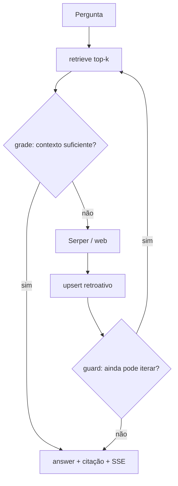

# Relatório dos materiais — Unidade 2: Orquestração Cognitiva e APIs

> Capstone AI Researcher · aulas 8–13  
> Pasta: `modulo-11-exemplo-2-orquestracao-cognitiva/materiais_aula`

## O que esta unidade constrói

O **cérebro** do agente:

1. Banco vetorial com **pgvector** + seed do corpus CVM  
2. Nós **retrieve** e **grade** (buscar e julgar contexto)  
3. **Serper** + fallback web + **upsert** retroativo  
4. Grafo real com **aresta condicional** e **guard do loop**  
5. Nó **answer** com citação obrigatória, guardrail por código e **streaming SSE**

## Como estudar (ordem intuitiva)

```
1. Vetores             →  Diagrama 2.1a (distância e top-k)
2. SQL vetorial        →  Diagrama 2.1b (pgvector)
3. Escala              →  Diagrama 2.1c (HNSW)
4. Grafo               →  aulas 9–13 + Diagrama 1.1 (Unidade 1)
5. Pratique            →  seed → implementação dos nós
6. Valide              →  checkpoint
```

## Slides desta unidade

| Arquivo | Lê em 1 frase | Quando abrir |
|---------|---------------|--------------|
| [`Diagrama 2.1a — Distância vetorial e top-k.pptx`](./Diagrama%202.1a%20—%20Distância%20vetorial%20e%20top-k.pptx) | Perto no espaço = parecido no significado; top-k ≠ “o certo” | Antes do retrieve |
| [`Diagrama 2.1b — pgvector.pptx`](./Diagrama%202.1b%20—%20pgvector.pptx) | Extensão do Postgres; `<=>` = cosseno; top-k em uma linha SQL | Ao criar a query |
| [`Diagrama 2.1c — Índice HNSW.pptx`](./Diagrama%202.1c%20—%20Índice%20HNSW.pptx) | Busca aproximada em camadas — rápida em escala | Ao falar de índice |

### Leitura guiada 2.1a — distância e top-k

- Documentos (Ambev, B3, Petrobras…) viram pontos no espaço.
- A pergunta do usuário também.
- **Cosseno** mede ângulo (semântica), não tamanho do texto.
- **top-k** devolve os k mais próximos — candidatos, não verdade absoluta.

### Leitura guiada 2.1b — pgvector

| Operador | Distância | Neste projeto |
|----------|-----------|---------------|
| `<->` | euclidiana | — |
| `<#>` | produto interno | — |
| `<=>` | cosseno | **sim** |

```sql
ORDER BY embedding <=> :pergunta LIMIT 5
```

Uma linha de SQL — sem serviço vetorial separado.

### Leitura guiada 2.1c — HNSW

```
camada esparsa (topo)  →  saltos longos
camada intermediária
camada densa (base)    →  vizinhos finos
```

- Busca **exata**: compara com todos.
- **HNSW**: aproximada, muito mais rápida quando o corpus cresce.

## Mapa das aulas (PDF)

| Aula | Arquivo local | Ideia central |
|------|---------------|---------------|
| 8 | [`../docs/exemplo_aula/AULA_08_PGVECTOR_SEED.md`](../docs/exemplo_aula/AULA_08_PGVECTOR_SEED.md) | Extensão, seed, top-k |
| 9 | [`../docs/exemplo_aula/AULA_09_RETRIEVE_GRADE.md`](../docs/exemplo_aula/AULA_09_RETRIEVE_GRADE.md) | Buscar trechos × julgar se bastam |
| 10 | [`../docs/exemplo_aula/AULA_10_SERPER.md`](../docs/exemplo_aula/AULA_10_SERPER.md) | API de busca web |
| 11 | [`../docs/exemplo_aula/AULA_11_FALLBACK_UPSERT.md`](../docs/exemplo_aula/AULA_11_FALLBACK_UPSERT.md) | Web → enriquecer base → citar |
| 12 | [`../docs/exemplo_aula/AULA_12_GRAFO_GUARD.md`](../docs/exemplo_aula/AULA_12_GRAFO_GUARD.md) | Aresta condicional + corte de loop |
| 13 | [`../docs/exemplo_aula/AULA_13_ANSWER_SSE.md`](../docs/exemplo_aula/AULA_13_ANSWER_SSE.md) | Citação, guardrail, stream token a token |

## Fluxo do grafo (versão de estudo)



## Conceitos que não podem confundir

| Confusão comum | Correção |
|----------------|----------|
| “top-1 é a resposta certa” | top-k só ranqueia candidatos |
| “Fallback inventa o fato” | Web enriquece a base; resposta **cita** |
| “O LLM decide quando parar o loop” | **Guard por código** limita iterações |
| “Citação no prompt basta” | Guardrail de citação também no **código** |

## Roteiro prático sugerido

1. Abrir os 3 PPTX na ordem 2.1a → 2.1b → 2.1c.
2. Rodar o seed do corpus no Postgres com pgvector.
3. Implementar retrieve → grade (sem web ainda).
4. Ligar Serper + upsert + guard.
5. Fechar com answer + SSE e checar citações.

Repos: [seed](https://github.com/unipds-engenharia-de-ia-aplicada/ai-researcher-seed) · [completo](https://github.com/unipds-engenharia-de-ia-aplicada/capstone-project-ai-researcher)

## Checkpoint

- [ ] Escrever de memória a query `<=> … LIMIT k`
- [ ] Explicar HNSW vs busca exata
- [ ] Desenhar aresta grade → answer | web
- [ ] Dizer onde o guard corta o loop
- [ ] Ponte Guardião: [`../docs/exemplo_real/01-guardiao/aplicacao.md`](../docs/exemplo_real/01-guardiao/aplicacao.md)

## Relatório didático da unidade

[`../docs/exemplo_aula/RELATORIO_DIDATICO_AULA.md`](../docs/exemplo_aula/RELATORIO_DIDATICO_AULA.md)
