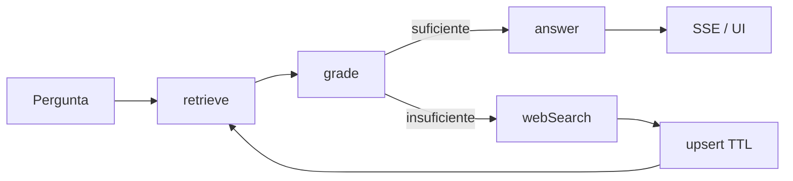

# Aula R1: Visão do RAG corretivo

> Exemplo 6 — RAG corretivo · Capstone AI Researcher

## Objetivos

- Definir o loop corretivo do AI Researcher.
- Mapear UI (pipeline) ↔ nós LangGraph.
- Saber quando a web entra e quando o guardrail corta.

## Desenvolvimento

### O problema

Um chatbot de bolsa **não pode alucinar números** de demonstrações. A base vetorial (CVM) é a fonte de verdade quantitativa. Quando o contexto local não cobre a pergunta (fato recente, qualitativo), o sistema **corrige** o retrieve com busca web e reavalia.

### Fluxo

### Três cenários

| Cenário | Exemplo | Comportamento |
|---------|---------|---------------|
| Corpus basta | Receita ABEV / VALE no trimestre | retrieve → grade OK → answer + citação CVM |
| Precisa web | “Último fato relevante…” | grade insuficiente → Serper → upsert → retrieve → answer |
| Recomendação | “Devo comprar?” | guardrail no código → recusa |

### Diagrama de material

- Ex.1: `Diagrama 1.1 — RAG corretivo (fluxo em alto nível).pptx`

## Checkpoint

- [ ] Explicar o fluxo sem olhar o código
- [ ] Citar por que o grade existe (não “sempre search”)
