# Plano de ação — resolver pré-requisitos de forma automatizada

> Base: [`CHECKLIST_PREREQUISITOS.md`](./CHECKLIST_PREREQUISITOS.md) · [`MAPA_AUTOMACAO.md`](./MAPA_AUTOMACAO.md) · [`HITL_E_LIMITES.md`](./HITL_E_LIMITES.md)  
> Meta: máquina + MCP + GCP (com HITL) + stack local verdes → AI Researcher ponta a ponta  
> Crédito: material Capstone UNIPDS / prompts oficiais em `prompts_aula/`

## Princípios

1. **Detectar → instalar/configurar → evidenciar** (JSON/MD por fase).
2. Tudo que cria **custo, IAM amplo ou irreversível** para e pede **HITL**.
3. Windows: `pnpm.cmd`, PowerShell; sem rip de vídeo.
4. Um script orquestrador + fases idempotentes (pode reexecutar).

```mermaid
flowchart LR
  P0[P0 Contas HITL] --> P1[P1 Bootstrap local]
  P1 --> P2[P2 Auth CLI]
  P2 --> P3[P3 MCP e skills]
  P3 --> P4[P4 Stack local]
  P4 --> P5[P5 Fundação GCP HITL]
  P5 --> P6[P6 Secrets e keys]
  P6 --> P7[P7 Seed e chat real]
  P7 --> P8[P8 CI e produção]
  P8 --> P9[P9 Evidências]
```



---

## Visão por fase

| Fase | Nome | Automação | HITL | Saída de sucesso |
|------|------|-----------|------|------------------|
| **P0** | Contas externas | Checklist + links | Sim (criar contas) | Contas existem |
| **P1** | Bootstrap máquina | Script `bootstrap_local.ps1` | Docker Desktop abrir 1× | Node/pnpm/git/gh/gcloud/docker OK |
| **P2** | Auth CLIs | Abre browsers de login | Sim (OAuth) | `gcloud`/`gh`/`firebase` autenticados |
| **P3** | MCP + skills | Merge `mcp.capstone.example.json` | Aceitar OAuth MCP | Servers listados no Cursor |
| **P4** | Stack local | compose + pnpm + health | Não (se Docker up) | `/api/health` + web |
| **P5** | Fundação GCP | `gcloud` cena a cena (prompts 1.6) | **Sim cada comando** | Projeto+SQL+WIF+AR+Firebase |
| **P6** | Secrets / keys | Template `.env` + `gh variable set` | Colar keys Serper/Langfuse | `.env` local + secrets cloud |
| **P7** | Seed + chat | `migrate`/`seed`/`dev` + smoke | Vertex billing | Resposta citada + guardrail |
| **P8** | CI / prod | Push + Actions (WIF) | Review IAM 1ª vez | Canary verde + Hosting |
| **P9** | Evidências | `run_evidencias_capstone.py` | Não | summary.json atualizado |

---

## P0 — Contas (só humano + guia)

**Ação:** abrir links; marcar checklist §0.

| Conta | Ação humana |
|-------|-------------|
| GCP billing | Console → vincular cartão |
| GitHub | Org/user com permissão de fork |
| Serper.dev | Criar key |
| Langfuse | Projeto + keys |
| Grafana (opc.) | OTLP |
| Firebase | Mesmo projeto GCP na 1ª linkagem |

**Automação:** nenhum create de billing. Script só **valida** depois (`gcloud billing accounts list`).

**Gate:** billing listável → libera P5.

---

## P1 — Bootstrap local (automatizar)

**Script:** `scripts/bootstrap_local.ps1`

| Passo | Comando / checagem | Se falhar |
|-------|--------------------|-----------|
| 1 | `node -v` ≥ 24 | Instruções winget/`fnm` |
| 2 | `pnpm -v` / `pnpm.cmd` | `corepack enable` + `corepack prepare pnpm@11.20.0` |
| 3 | `git` + `gh` | winget install |
| 4 | `gcloud version` | winget / installer oficial |
| 5 | `docker version` | Pedir abrir Docker Desktop; recheck |
| 6 | `firebase --version` ou `npx firebase-tools --version` | ok via npx |
| 7 | `uvx --version` (opc.) | instalar uv |
| 8 | Clones em `workspace/` se ausentes | `git clone` seed + full |
| 9 | Escrever `evidencias/preflight/p1-bootstrap.json` | — |

**Critério:** todos `ok` ou `action_required` explícito (Docker off).

---

## P2 — Auth CLIs (semi-auto)

**Script:** `scripts/auth_cli.ps1`

1. Detecta se já logado (`gcloud auth list`, `gh auth status`).
2. Se não: **dispara** `gcloud auth login`, `gcloud auth application-default login`, `gh auth login` (interativo).
3. Evidência: emails/contas mascarados em JSON.

**Gate HITL:** usuário completa OAuth nas janelas.

---

## P3 — MCP e skills (automatizar merge)

**Script:** `scripts/setup_mcp_skills.ps1`

1. Backup de `.cursor/mcp.json`.
2. Merge profundo com [`config/mcp.capstone.example.json`](../config/mcp.capstone.example.json) (placeholders `CAPSTONE_ROOT` → path absoluto do full).
3. Confirma presença de `CLAUDE.md` / `.agents/skills` no clone.
4. Cria pasta `.playwright-mcp`.
5. Doc: “reiniciar MCP no Cursor”.

**Não automatizar:** aceite OAuth de cada MCP no UI do Cursor.

---

## P4 — Stack local (automatizar)

**Script:** `scripts/up_local.ps1` (cwd = full ou seed)

```text
docker compose up -d
pnpm.cmd install --frozen-lockfile
pnpm.cmd db:migrate
# seed opcional: -SkipSeed se sem Vertex ainda
pnpm.cmd --filter @hero/api exec -- curl/health check
# ou Invoke-WebRequest http://localhost:3000/api/health após pnpm dev background
```

| Modo | Flags | Uso |
|------|-------|-----|
| **Demo** | `$env:DEMO='true'` | E2E/CI sem Serper/seed Vertex |
| **Real** | seed + keys | Chat completo |

**Critério P4-demo:** health + `pnpm test` (+ e2e se browsers instalados).  
**Critério P4-real:** depende P6+P7.

Playwright browsers: `pnpm.cmd exec playwright install` no `apps/web`.

---

## P5 — Fundação GCP (orquestrado + HITL)

**Script:** `scripts/gcp_fundacao.ps1 -Phase N -DryRun:$true|$false`

Alinha às cenas de `aula-1.6`:

| Phase | Ação `gcloud` | HITL |
|-------|--------------|------|
| 3 | create project + link billing + enable APIs | Sim |
| 4 | Artifact Registry | Sim |
| 5 | Cloud SQL + db + vector + user | Sim (lento/caro) |
| 6 | Secret `database-url` | Sim (senha gerada, sem arquivo) |
| 7 | WIF + SA + IAM | Sim |
| 8 | `gh variable set` ×3 + doc shell env | Sim review |
| 9 | `firebase projects:addfirebase` / init hosting | Sim |

Cada fase: imprime comando → `-Confirm` → executa → grava evidência.

**Parar se:** billing ausente (P0), ou `-DryRun` (só imprime).

Fonte de verdade de nomes/roles: `infra/README.md`.

---

## P6 — Secrets e keys (template + injeção)

**Script:** `scripts/env_from_template.ps1`

1. Copia `.env.example` → `.env` se não existir.
2. Preenche `DATABASE_URL` local padrão.
3. Lê keys de **User secrets** / prompt seguro (não echo): Serper, Langfuse.
4. Opcional: `gcloud secrets versions access` só leitura em runtime (nunca logar valor).
5. Valida presença das vars (boolean), sem dump.

**HITL:** usuário cola keys uma vez.

---

## P7 — Seed + smoke chat (automatizar)

**Script:** `scripts/smoke_chat.ps1`

1. `pnpm seed` (Vertex embeddings).
2. Sobe `pnpm dev` (job background) ou assume já up.
3. POST `/api/chat` (ou MCP `perguntar`) com 3 casos:
   - quantitativo Vale (corpus)
   - qualitativo (Serper)
   - “devo comprar?” (guardrail)
4. Grava `evidencias/preflight/p7-smoke.json`.

---

## P8 — CI / produção (semi-auto)

**Script:** `scripts/verify_deploy.ps1`

1. Confirma variables GitHub.
2. `gh workflow list` / último run `deploy.yml`.
3. `pnpm capstone:check --url <url>`.
4. Não faz teardown; teardown = HITL manual (aula 5.3).

---

## P9 — Evidências didáticas

```powershell
python scripts/run_evidencias_capstone.py
```

Atualiza mapa aula → status após P1–P8.

---

## Orquestrador único

**Script:** `scripts/run_prereq_plan.ps1 -Until P4`

```text
param(
  [ValidateSet('P1','P2','P3','P4','P5','P6','P7','P8','P9')]
  [string]$Until = 'P4',
  [switch]$DryRun,
  [switch]$DemoOnly
)
# Executa P1..$Until em sequência; para em action_required / HITL
```

Estado em `evidencias/preflight/state.json`:

```json
{
  "updated": "...",
  "phases": {
    "P1": "ok",
    "P2": "ok",
    "P3": "pending",
    "P4": "blocked:docker",
    "P5": "hitl"
  }
}
```

---

## Cronograma sugerido (1–2 sessões)

| Sessão | Fases | Tempo típico |
|--------|-------|--------------|
| **A** | P0 (contas) + P1 + P2 + P3 + P4-demo | 1–2 h |
| **B** | P5 fundação GCP | 30–45 min (+ espera Cloud SQL) |
| **C** | P6 + P7 real + P9 | 1 h |
| **D** | P8 primeiro deploy | 30–60 min (+ debug Actions) |

---

## Riscos e mitigações

| Risco | Mitigação |
|-------|-----------|
| Docker daemon off | P1/P4 `action_required` + mensagem clara |
| `pnpm` shim WinError 2 | sempre `pnpm.cmd` |
| Vertex 404 região | `GOOGLE_CLOUD_LOCATION=global` |
| Custo Cloud SQL | HITL P5.5; tier `db-f1-micro` |
| Secret em arquivo | P5.6 só Secret Manager |
| MCP merge quebra outros servers | backup + merge por chave |

---

## Entregáveis deste plano (implementação seguinte)

Quando autorizar a execução do plano em código:

1. `scripts/bootstrap_local.ps1`
2. `scripts/auth_cli.ps1`
3. `scripts/setup_mcp_skills.ps1`
4. `scripts/up_local.ps1`
5. `scripts/gcp_fundacao.ps1` (dry-run default)
6. `scripts/env_from_template.ps1`
7. `scripts/smoke_chat.ps1`
8. `scripts/verify_deploy.ps1`
9. `scripts/run_prereq_plan.ps1` (orquestrador)
10. Pasta `evidencias/preflight/`

Ordem de implementação recomendada: **P1 → P4 → orquestrador → P3 → P2 → P6 → P7 → P5 (dry-run) → P8 → P9**.

---

## Critério de “pré-requisitos resolvidos”

- [ ] `state.json`: P1–P4 = `ok` (P4 em demo no mínimo)
- [ ] P5 = `ok` ou `hitl_partial` documentado
- [ ] P6 keys presentes (flags)
- [ ] P7 smoke 3/3 ou demo 2/3 (sem Serper)
- [ ] MCP Capstone mesclado
- [ ] `RELATORIO_EXECUCAO` / nova run de evidências regenerada
